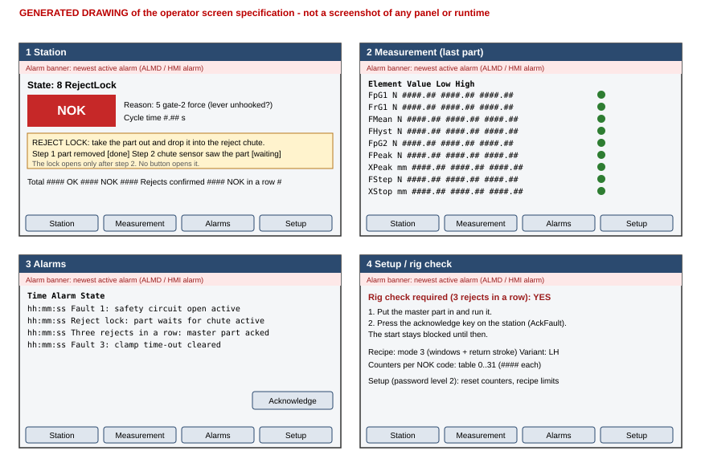

# PanelView operator screen: specification

> **This is a specification, not a built application.** No FactoryTalk View or PanelView software was available. Nothing here was created, compiled or run. The drawing is **generated** by `tools/make_screen_drawing.py` and is not a screenshot.

*Generated drawing. Every value on it is a placeholder.*

## Panel and connection

- An 800 x 480 graphic terminal, assumed. The model was not chosen, and no PanelView catalogue was read.
- Tags are read by name from the controller: `[PLC]Program:StationProgram.Station.State`. The path form is the usual one for direct controller tag references, but **it was not checked in a FactoryTalk manual**.
- Only parameters of the AOI instance can be addressed. Local tags such as `Station.Eval` are not visible outside the AOI (1756-PM010I p. 19). That is why the station AOI has the outputs `E_FpG1` ... `E_XStop`.

## Tags

All tags are in program `StationProgram`.

| Tag | Type | Access | Screen | Use |
|---|---|---|---|---|
| `Station.State` | INT | read | 1 | State number. Text from a multistate indicator: 0 Idle ... 10 Home |
| `Station.Verdict` | INT | read | 1 | 0 none, 1 OK (green), 2 NOK (red) |
| `Station.NokCode` | INT | read | 1 | NOK reason through a 32-state text list (codes 1-10, 20-24, as in the block header) |
| `Station.TCycle` | REAL | read | 1 | Clamp to verdict, s |
| `Station.Locked` | BOOL | read | 1 | Reject-lock banner visible |
| `Station.QCallOperator` | BOOL | read | 1, 3 | Operator called |
| `Station.CntTotal`, `CntOk`, `CntNok`, `CntRejectConfirmed` | DINT | read | 1 | Counters |
| `Station.CntConsecNok` | INT | read | 1 | NOK in a row |
| `Station.PartPresent` | BOOL | read (input parameter) | 1 | Reject-lock step 1 done when FALSE |
| `Station.E_FpG1` ... `Station.E_XStop` | REAL | read | 2 | Nine elements of the last part |
| `Rcp.MeanLo` ... `Rcp.StopXHi` | REAL | read, write at level 2 | 2, 4 | Limits next to each element |
| `Station.RigCheckRequired` | BOOL | read | 4 | Master part requested |
| `CntByCode[0]` ... `[31]` | DINT | read | 4 | Parts per NOK code |
| `ALM_SafetyOpen` ... `ALM_RigCheck` | ALARM_DIGITAL | read, `OperAck` write | 3 | Alarm list |
| `AlmAck` | BOOL | write | 3 | Acknowledge all (ProgAck operand of every ALMD) |

There is **no screen button for the acknowledge key** of the station (`Station.AckFault`). The rig-check release and the fault acknowledge stay on the hard-wired key at the station, as in the Siemens original. That is a design choice, not a platform rule.

## Screens and navigation

The navigation bar is on every screen: **Station - Measurement - Alarms - Setup**. The alarm banner at the top shows the newest active alarm and opens screen 3 when touched.

| Screen | Content |
|---|---|
| 1 Station | State text; verdict lamp; NOK reason text; cycle time; counters. While `Locked`, a banner with two steps: 1 "part removed" (`PartPresent` FALSE), 2 "chute sensor saw the part" (waits until the station leaves state 8). The lock has **no** screen button: the block opens it only after both steps. |
| 2 Measurement | Table of the nine elements with low limit, value, high limit and a status dot (inside or outside its limits). The limits come from `Rcp`. |
| 3 Alarms | Alarm list of the six ALMD alarms with time, text and state. Acknowledge button. |
| 4 Setup / rig check | Rig-check request with the two steps for the operator (master part, then the acknowledge key); recipe mode and variant; counters per NOK code. Limit editing and counter reset behind security level 2. |

## Alarms

| Tag | Severity | Condition | Text |
|---|---|---|---|
| `ALM_SafetyOpen` | 900 | `Station.FaultCode = 1` | Fault 1: safety circuit open |
| `ALM_DriveNotReady` | 800 | `Station.FaultCode = 2` | Fault 2: drive not ready |
| `ALM_ClampTimeout` | 700 | `Station.FaultCode = 3` | Fault 3: clamp did not close in time |
| `ALM_TareFailed` | 700 | `Station.FaultCode = 4` | Fault 4: load cell does not tare |
| `ALM_RejectWaiting` | 500 | `Station.Locked AND Station.QCallOperator` | Reject lock: part waits for the reject chute |
| `ALM_RigCheck` | 600 | `Station.RigCheckRequired` | Three rejects in a row: run the master part |

These are ALMD instructions in the controller (1756-RM003P pp. 44-46): acknowledge required, not latched. The severities are a choice; their meaning on the panel was not read.
